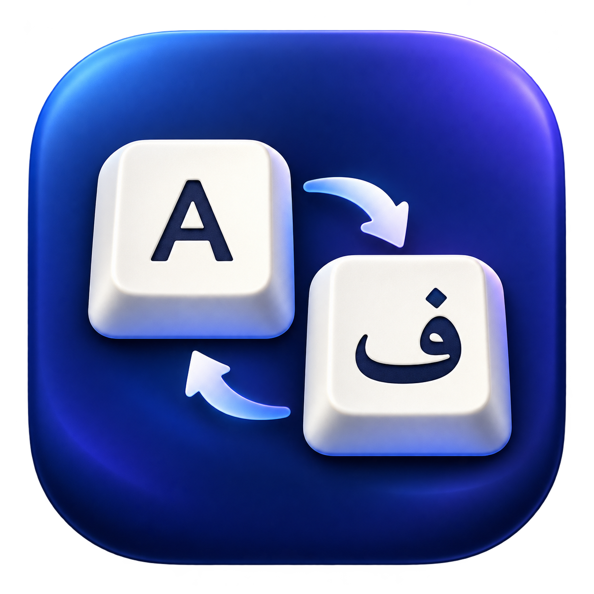

# Keyboard AutoLang



A small native macOS menu bar utility that selects a keyboard input source per application. Built with Swift, AppKit, Carbon and Accessibility notifications; no polling loop or third-party runtime libraries. The settings panel is currently in Persian.

## Features

- Terminal defaults to English; Telegram to Persian; other apps remember their last source.
- Choose an installed keyboard layout, remember the last source, or leave the current source unchanged.
- Finder and System Settings appear in the panel. Their fixed rules apply on activation and focus changes, including search fields.
- Spotlight support uses focus notifications, including the Siri AI host observed on macOS 27. Its behavior may vary across OS releases.
- App icon in the menu bar and settings panel; app list excludes missing application bundles.

## Install from source

Tested on Apple Silicon with macOS 27. The installer targets macOS 27 or later. Earlier systems and Intel have not been validated.

Requires an existing Apple Swift compiler and Python 3. The installer does not download dependencies. Clone this repository, inspect the code, then run:

```sh
python3 install.py
```

The installer builds locally, backs up an existing installation, installs `~/Applications/Keyboard AutoLang.app`, and registers a per-user LaunchAgent. Existing rules are preserved. Open the app or click its menu bar icon to configure it.

Enable the input sources you need in System Settings → Keyboard → Text Input. Disable automatic per-document input source switching if it conflicts with this utility. Grant Accessibility access to Keyboard AutoLang for Spotlight and focus changes. Local ad-hoc signed rebuilds may require removing and re-adding the app in Accessibility settings.

## Privacy

No network requests, telemetry, typed-text capture, or keystroke logging. The app observes application activation and window/focus events. Accessibility is a broad macOS permission; this implementation only queries focus metadata.

Local files under `~/Library/Application Support/KeyboardAutoLang` include rules, remembered input sources and diagnostic logs containing application names/identifiers. They are not uploaded. Review logs before sharing them. This repository contains no personal configuration or diagnostic logs.

## Stop automatic execution

```sh
launchctl bootout "gui/$(id -u)/local.keyboardautolang"
rm -f "$HOME/Library/LaunchAgents/local.keyboardautolang.plist"
```

Your rules and backups remain available. This does not remove other applications or change macOS input-source preferences.

## Development

```sh
xcrun swiftc -O -swift-version 5 -framework AppKit -framework Carbon main.swift Panel.swift -o KeyboardAutoLang
```

Verification so far: local compilation, code-signature validation, and manual app/focus switching tests. Battery usage has not been quantitatively measured. There is no guarantee of zero latency under all system conditions.

The app icon was generated using OpenAI ImageGen. Code and bundled assets are distributed under the MIT license. Contributions are welcome; do not include personal rules, logs, credentials, or app inventories in issues or pull requests.
